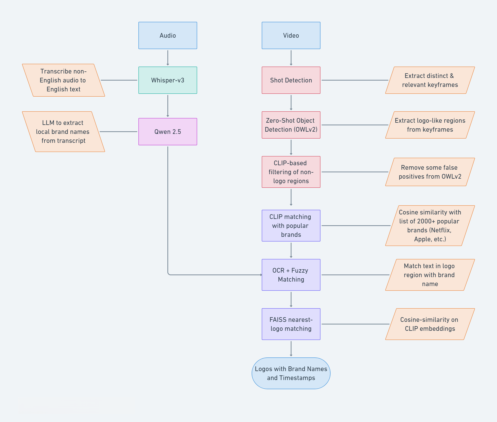

# 🎯 Semi-Automated Logo Detection in Brand Advertisement Videos

An application for semi-automated logo detection in brand advertisement videos using multimodal machine learning.

## Overview


This is an application that allows detection of logos in non-English brand advertisement videos using multimodal ML techniques. The overall pipeline is:
- Run the `Whisper` model on audio of the advertisement to transcribe it from the source language (Italian for e.g.) to English.
- Apply an LLM like `Qwen 2.5` to obtain all brand names mentioned in the audio transcript.
- Run _shot detection_ on the video to obtain the most distinct, relevant keyframes.
- On each keyframe, run a _zero-shot object detection_ model such as `OWLv2` with prompt to extract as many _logo-like_ regions as possible i.e. crops that may contain an actual logo.
- Candidate regions are filtered using a combination of **heuristic filters** (area, aspect ratio, texture, edge density, color variance) and **CLIP-based filtering** to remove false positives.
- All of the crops/regions then run through the following brand assignment techniques:
  - Use `CLIP` model to assign each region a brand from a list of top ~2000 brands (Netflix, Apple, etc.) obtained publicly from Kaggle.
  - Use `Optical Character Recognition (OCR)` along with `fuzzy string matching` to assign leftover regions a brand from the brand names extracted from the audio.
  - Use `FAISS` vector store to assign leftover regions a brand from the nearest-matching logo in the vector store. The vector store is pre-populated with the [LogoDet-3K](https://github.com/Wangjing1551/LogoDet-3K-Dataset) dataset for now.
- Optionally, a `Qwen` post-filtering step verifies each detected logo as Correct / Incorrect / Other.
- The `FAISS` vector store enables continual learning of new logos over time via human labelling, logo scraping, etc.
- A `Gradio` application allows the user to upload a video, run the pipeline, and view the matched regions/logos with corresponding brand names and timestamps.

## Advantages
- No need for manual training/fine-tuning of object detection models on custom logos.
- Local, indigenous brands detected using the audio transcript with OCR & fuzzy matching.
- CLIP model works quite well for detecting global, popular brands.
- Vector stores like FAISS enable continual learning and detection of new logos over time.
- Overall pipeline is agnostic to the domain (Ads, sports, etc.) and the source language.
- Multiple embedding model options for the FAISS store: **CLIP**, **DINOv2**, **SigLIP2**, or a hybrid — each with separate benchmarks to guide model selection.

### Streamlit — FAISS Logo Manager (`app/streamlit_faiss_app.py`)
A companion UI for managing and evaluating the logo vector store.

- **Logo Search**: Query the FAISS index with an image to find the nearest matching logo, with optional Test-Time Augmentation (TTA) for more robust retrieval.
- **Logo Ingestion**: Add new logo images to the index (with optional augmentation) to expand coverage over time.
- **Metrics**: Track retrieval quality and accept/reject results to maintain a feedback log.
- **Embedding model selection**: Switch between CLIP and SigLIP2 indexes from the sidebar.

## Usage

### Installation

Clone the repository and set up a virtual environment (optional but recommended):

```bash
git clone <repo-url>
cd Logo-Detection
python -m venv .venv && source .venv/bin/activate  # or .venv\Scripts\activate on Windows
```

Install dependencies for your platform:

```bash
# macOS
pip install -r requirements-macos.txt

# Windows
pip install -r requirements-win.txt
```

### Running the Streamlit app

```bash
cd app
streamlit run streamlit_faiss_app.py
```

## Benchmarking

The `benchmarks/` directory contains a full evaluation framework for comparing embedding models on logo retrieval:

- **Leave-One-Out (LOO) evaluation**: `benchmarks/run_loo_benchmark.py`
- **Crop-level evaluation**: `benchmarks/run_crop_benchmark.py`
- Supported models: CLIP, DINOv2, SigLIP2, and a DINOv2+CLIP hybrid.
- Results (CSV + plots) are saved to `benchmarks/results/`.

## Notebooks

Code for object detection models and VLMS is found in `Notebooks/`:

| Notebook | Description |
|---|---|
| `Phase1_Obj_det_Models_Testing.ipynb` | Comparison of object detection models for logo region proposal |
| `Phase1-Qwen3-Testing.ipynb` | Evaluation of Qwen models for brand name extraction |

> Note: Notebooks are designed to run on Google Colab due to GPU requirements.

## Running M3

Milestone 3 replaces the ad-hoc scripts above with a configured pipeline,
`logo_pipeline/`, driven end to end by one YAML. See `spec docs/` for the
full specification set; this section is the quickstart. `logo_pipeline`'s
own package docstring and `spec docs/03_architecture.md` are the source of
truth if this section and the code ever disagree.

### Environment

Two environments are involved, split by which stages need a GPU:

- **CPU path** (`requirements-macos.txt` or `requirements-win.txt`): ingest,
  shot detection, sampling, merge, refinement, canonicalisation, watermark,
  routing and output all run anywhere. OCR and FAISS querying work on CPU
  (slower) or GPU.
- **GPU path** (add `requirements-gpu.txt` on top): Grounding DINO and YOLO
  detection, Whisper + the text-LLM audio brand extraction, and the VLM call
  all need a real GPU to run in reasonable time — the VLM stage in
  particular loads a 7B-parameter model in 4-bit and is not practical on a
  Mac. A run directory is a plain folder, so the usual flow is: run
  `ingest` through `detect_gdino`/`detect_yolo` on the GPU machine, copy the
  run directory to the CPU machine, then run the rest with `--from-stage`.

### The YAML

`configs/pipeline.yaml` is the single config every run reads; every
threshold and switch used anywhere in the pipeline lives there (see
`spec docs/04_config_yaml_spec.md` for the key-by-key reference). It is
generated from `logo_pipeline/config.py`'s dataclass schema, so the file and
the loader's validation cannot drift — edit values freely, but adding or
removing a *key* means editing the schema in `config.py` too, since unknown
keys fail validation.

Per-video facts (source path, channel, watermark regions, and any
`pipeline.yaml` overrides specific to that video) live in
`configs/videos/<video_id>.yaml` and are merged in at load time. Two are
checked in as working examples: `configs/videos/video_1.yaml` and
`configs/videos/video_3-trimmed.yaml`.

### The two ingest modes

- **Video** (default): `source: <path>.mp4` in the per-video file. Frame
  rate and count come from the container.
- **Frame folder** (for the `fixed-images` client folder, or any similar
  export): pass `--frames-dir fixed-images` on the command line, or set
  `ingest.mode: frames` / `ingest.frames.dir` in an override. Frames are
  read as `{video_id}_frame_<ordinal>.png` in numeric ordinal order; there
  is no audio track in this mode (`audio_signal_status: signal_unavailable`
  on every row), and the frame rate is an assumed value recorded as
  `fps_is_assumed: true` in the run manifest.

### Running a video

```bash
python -m logo_pipeline run \
    --config configs/pipeline.yaml \
    --video-config configs/videos/video_3-trimmed.yaml
```

Useful flags:

- `--from-stage <name> --to-stage <name>` — run a contiguous slice of the
  16-stage plan (`ingest, shots, sampling, detect_gdino, detect_yolo,
  merge, refine, ocr, faiss_query, audio, vlm, canonicalise, watermark,
  router_input, router, output`). This is how the GPU machine runs
  `ingest…detect_yolo` and a CPU machine finishes `merge…output` on the
  copied run directory.
- `--stages a,b,c` — an explicit subset instead of a contiguous slice.
- `--force` — re-run stages even if `stage_status.json` already marks them
  done at the current config hash (a stage is otherwise skipped whenever
  its outputs exist and were produced by an identical resolved config).
- `--frames-dir <dir> --video-id <id>` — run in frame-folder mode without
  writing a per-video YAML file first (handy for a quick `fixed-images`
  check).
- `--run-id <id>` — pin the run directory name instead of the default
  `YYYYMMDD-HHMMSS-<config_hash[:8]>`.

### Where outputs land

Everything for one run lives under `runs/<video_id>/<run_id>/`:
`run_manifest.json` (config snapshot, hash, brand-list version, git SHA,
signal switches), `stage_status.json` (per-stage status and timing),
`frames/` and `temporal/` (sampled and context frames), `raw_detections.jsonl`,
`merged_detections.jsonl`, `refinement.jsonl`, `ocr.jsonl`,
`faiss_hints.jsonl`, `audio/audio_hints.json`, `vlm/hinted.jsonl`,
`router_input.jsonl`, `router_output.jsonl`, `crops/<det>/…`,
`annotated_frames/`, and finally `rows.csv` — the frozen schema
(`spec docs/05_row_schema.md`), one row per surviving detection, loadable
directly in the existing review screen:

```bash
streamlit run app/review_ui.py -- --csv runs/video_3-trimmed/<run_id>/rows.csv
```

### Canonical brand list

`configs/brands/roboflow_2026-04-28.yaml` is the versioned snapshot of the
321-name client brand list (`spec docs/06_canonical_brand_list.md`). To add
a brand:

```bash
python -m logo_pipeline brands add "new brand" --aliases "alt spelling,another" \
    --list configs/brands/roboflow_2026-04-28.yaml
python -m logo_pipeline brands validate --list configs/brands/roboflow_2026-04-28.yaml
```

`brands validate` checks for alias collisions and reports the current
content hash; `brands hash` recomputes and rewrites it after any manual
edit. Every run records `brand_list_version` and `brand_list_hash` on every
row, so results stay comparable across list revisions.

### What's built so far (MM0 + MM1)

All 16 stages exist and run in the configured order. Detection (Grounding
DINO), OCR (hint form), FAISS querying, audio brand extraction and the
hinted VLM call are real, wrapping the M2 code in `generate_hints.py` and
`models/`. Merge, crop refinement, canonicalisation, watermark and the
router are intentionally pass-through stubs in this build — their
algorithms (T13–T19, T20–T24, T37, T47–T50, T38–T46) are later
mini-milestones; see `spec docs/07_MM0_MM1_foundation.md` onward. YOLO
detection is also a stub (T12, MM2) so the raw-detection file format is
fixed without a trained-weights dependency.

Run `pytest` from the repository root for the unit and fixture tests
(`spec docs/21_test_plan.md`).
